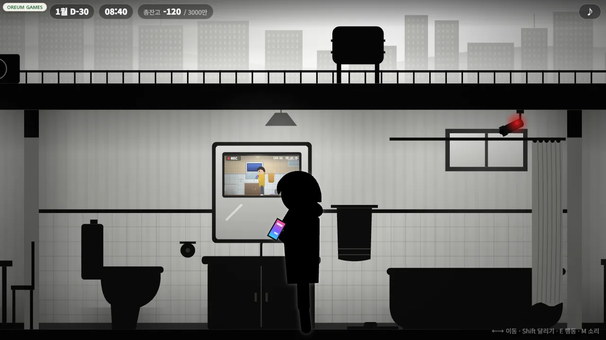
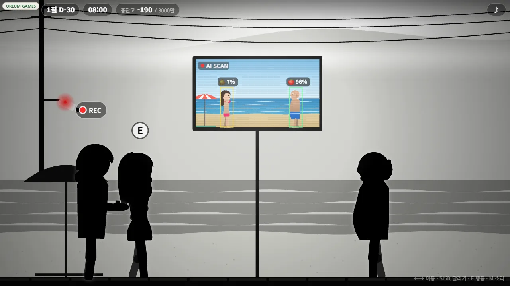
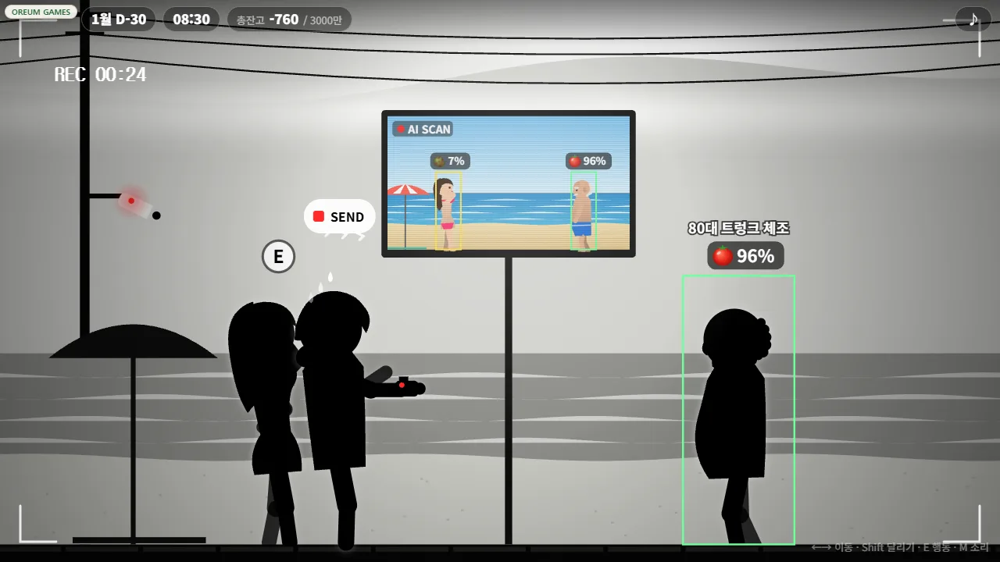

In a world where AI has taken people's jobs, would you sell videos of your private life if they became expensive training data? This is the story behind [300 A MONTH](/en/games/wol300/), a dystopian simulation that started as one sentence in the developer's head and went from idea to release in a single day, and the secret of its 30-million-won pistol ending.

## A strange idea that started with one sentence

It all began with one sentence from the developer.

"In the future, basic income will be 3 million won a month for selling your data to train AI."

Plenty of people already make money filming their daily lives for YouTube and social media. So what happens when the viewer is not a person but an AI? The game is built on that creepy, uncomfortably realistic question.

The title came straight from that sentence too. There was talk of adding a grand subtitle or an explanation, but the developer kept just the three characters of the Korean title, 월300. "If it only says 300 a month, people will wonder what on earth it means." For the title screen he handed over the poster for the movie 300 and said, "Let's go with this feel." A cramped studio flat drained to black and white, 월300 slashed across it in red brush strokes, and the main character at the head of the bed, eyes glued to his phone. It is a quietly tense picture.

## Five CCTV cameras are your basic income, and switching one off puts you in debt

The flat has five rooms: hallway, living room, kitchen, bathroom and bedroom. Each one has a CCTV camera on the ceiling. If you have no special talent or content to sell, streaming your own home 24 hours a day is your only base income.

* 600,000 won per room: keep all five cameras on and exactly 3 million won comes in each month.
* Zero left over: the catch is that basic living costs are also exactly 3 million won a month.
* The price of privacy: switch off even one camera because you are embarrassed to wash or sleep on camera, and that amount piles up as debt.

You won't starve without working, but to escape the endless watching and actually save money, you have to go outside and film something more shocking and rare. There are CCTV cameras in the alley too, and those can never be switched off. In this black-and-white world the only things with color are screens: TVs, monitors and billboards.

## A bikini selfie in her 20s gets 7%, an 80-year-old grandpa's exercises get 96%

The core system of 300 A MONTH is the AI freshness score. It rates, as a percentage, how rare a scene is as training data for the AI, and that sets the price.

"Bikini videos of young women are all over the internet, so they're worth little to an AI. A video of an 80-year-old grandpa exercising in his swim trunks has no human audience, but to an AI it's incredibly fresh data."

Because of this cold algorithm, a common bikini selfie on the beach sells for a measly 7%, while filming an 80-year-old doing his exercises in swim trunks scores a whopping 96%. The main character throws hearts and has a great time filming women in their 20s, and breaks into a heavy sweat filming the grandpa. But money is tight, so he ends up following the grandpa around, pressing the shutter.

The other rare data the AI goes crazy for is just as bizarre.

* A man in a suit swinging alone on a playground swing
* A man doing serious ballet at a bus stop
* A man having a serious conversation with pigeons in the park

The conclusion: people may watch young women, but the AI prefers middle-aged men (laughs)

At home, too, mistakes and embarrassments are money. Noodles boil over, you tip backwards off a chair, you slip on the soap in the shower, you sneak to the fridge after 10 pm, and your score goes up. The toilet scene, which nobody ever films, is worth 78%, and crying "How can a person's heart just change?" while hugging a lamppost after a shot of soju at a street food tent is worth a high 85%. The developer summed up the system in one line: "The more embarrassing your private life, the more it sells for."

## There is only one goal: a 30-million-won pistol

It is a game about scraping money together, but there is only one thing the main character can buy with it.

"The goal is 30 million won for a pistol. Buy the pistol with 30 million won and shoot every CCTV camera watching you, and that's the ending."

Get the pistol at the gun shop at the far end of the alley and smash all thirteen cameras watching the flat and the alley, and for the first time bright color floods into the gray world. Fail to save 30 million won within a year, and the story ends a very different way.

The game's economy is realistic too. Sell the same scene again and the price halves, then halves again, because the AI has already learned it. At first the money seems easy, then freshness runs dry and income drops steeply. On the other hand, a scene you hold back for a while slowly recovers its value every two days, so you have to plan carefully which embarrassment to sell, and when.

## Art and music all written in code: a game made in one day

The surprising part is that all of these systems and scenes were finished in a single day. There are no separate art assets and no outsourced music. Every picture on screen, the lazy lo-fi music in the daytime, the chilly ambient sound at night and the ticking sound while the record button runs were all built in code by Claude Code.

A day in the game starts at 8 am and ends at midnight, and every 30 days a cold monthly statement arrives. [300 A MONTH](/en/games/wol300/) is free to play right now in your PC or phone browser, with no download and no sign-up. (The Korean version, 월300, came out at the same time.)
