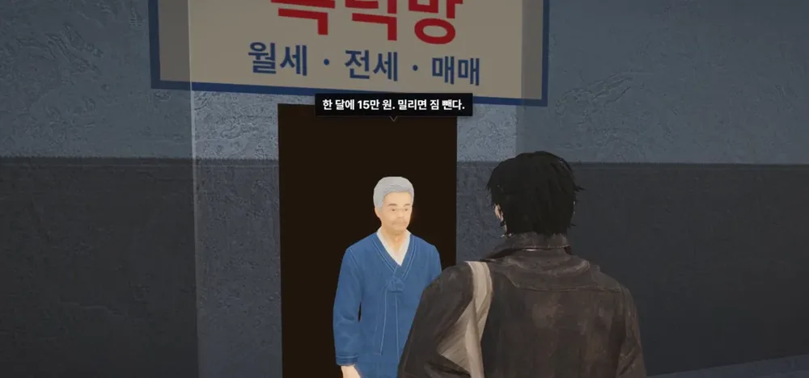
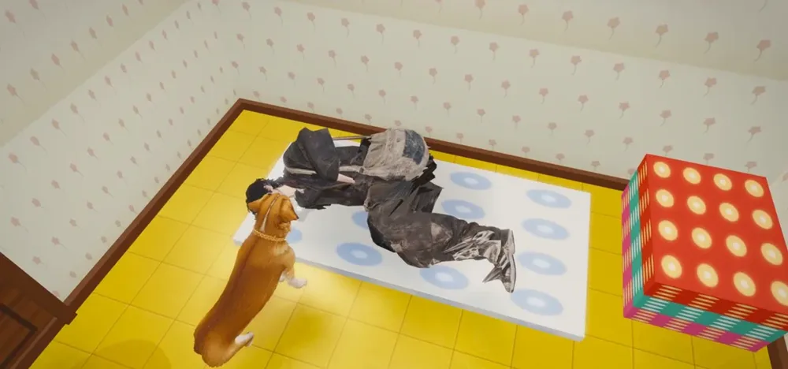
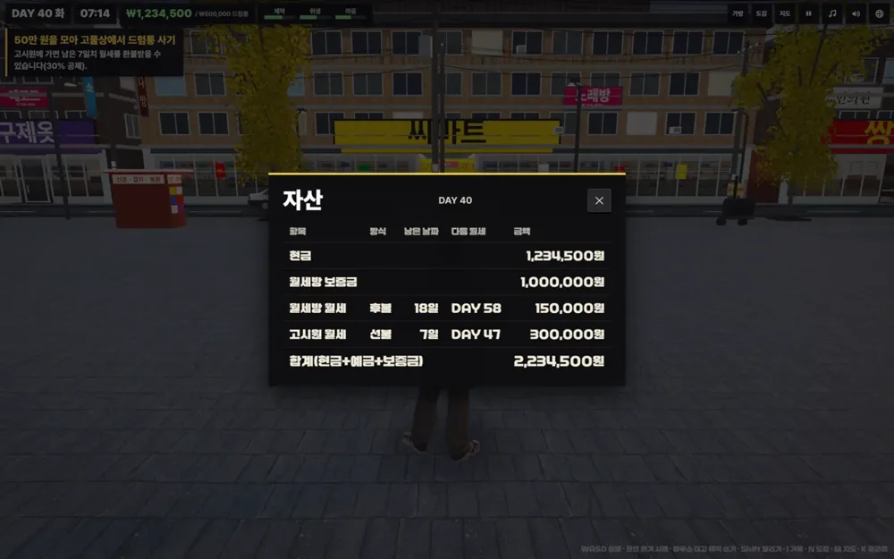
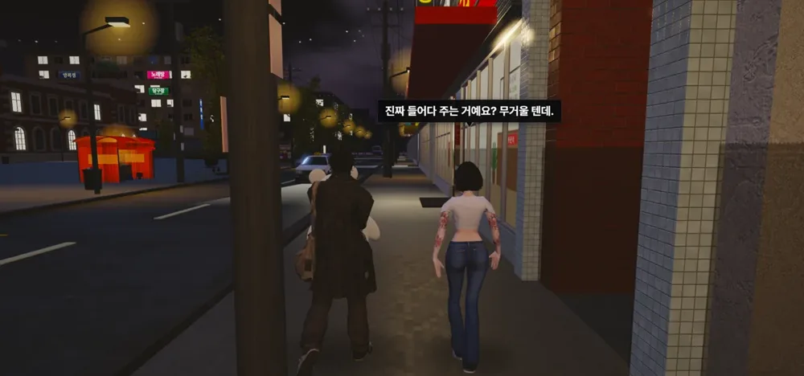
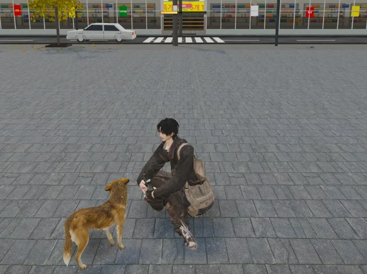
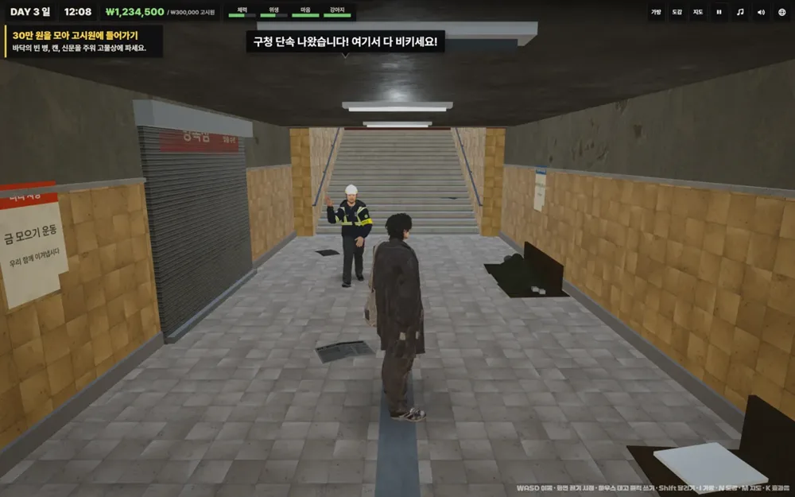

## Day after day of grinding construction shifts like a machine to save 1,000,000 won, and it felt like nothing

You save 1,000,000 won, tap the realtor's door, the money disappears, you see yourself lying in a room, and that's it. It's the moment a homeless man gets a room of his own for the first time, and it fell completely flat.

So I rebuilt it. The old realtor tells you the only place that takes dogs is the monthly room at the inn on the station plaza, and leads the way. Open the door of room 7 at the very back and there's a room with yellow vinyl flooring. The fluorescent light flickers on, the dog runs in first, and the hero lies down and says this is our home.

## I rented a room and then slept at the gosiwon

Even after renting the room, out of habit I tapped the gosiwon door and went in and slept there. Now when you rent a room, you count as having moved out of the gosiwon, and if you visit the manager he refunds the days you have left, minus 30%. I also made it so tapping the money at the top of the screen shows a table with the days left and when the next rent is due.

## Walking her home with a teddy bear

When you give the convenience store girl a huge teddy bear, she wonders how she's going to carry it home, and the hero says he'll carry it for her. Nothing came after that, so I asked Claude to make a scene of the two of them walking off with the bear.

The first thing it brought back was a palm-sized bear made of a few brown balls stuck together. The girl didn't hold it standing up, she knelt down to take it. The camera went inside the shop wall and filmed nothing but wall.

I told it to make the bear white and as big as a person, and a 1.5 meter bear swallowed the hero whole. I said it was too big and not fluffy at all, so it wrapped it in layers of fur and shrank it to 1.1 meters. Still too big, so it went down to 80 centimeters.

I asked if it couldn't just tuck the bear between his arms, and the bear floated in front of his body on its own. I said the bear was completely doing its own thing, and this time both hands came out through the bear's belly. While fixing that, it even deleted the end of the girl's first-meeting scene, which had nothing to do with it, and had to bring it back.

In the end I told it to stop and just end on the first shot, the two of them walking side by side from behind. Then a side view flashed for half a second after the back view. Only after that was gone was it finally done. The back view was the best part anyway.

## Every wrist was bent

When the hero or the girl just stood there, their wrists were bent inward at a horrible angle. I told it to fix that, and it straightened the wrists while standing.

But raising a hand was still the same. The rice cake grandma, the girl, the crackdown officers, the moment anyone raised a hand their arm bent backward or twisted. It was just adding a fixed angle on top of the walking or counter pose, so everyone twisted differently. So I lined everyone up on the street, had them all raise their hands together, and corrected the pose. Now the arm lifts out to the side and the palm ends up beside the face.

Feeding the dog used to be done kneeling, and now you squat instead. The girl squats when she pets the dog too. The cost is that the little up-and-down stroking motion she used to make is gone.

## The crackdown officers blew a whistle and left

I was playing the coin odd-or-even game and the district crackdown officers just blew a whistle and nothing happened. The officers only walked a fixed route above the plaza and only reacted if they bumped right into you, and the game spot was off that route. So I made an officer walk over and break up the game, saying gambling is illegal.

But in the underpass, too, it was just a whistle and nothing else. The underpass wasn't being checked at all. I made an officer come down and chase you out, and you did get chased out, but you couldn't see the officer. Only his speech bubble floated near the ceiling.

At first I thought he was hidden behind the hero's body because he stood right behind him, so I moved him. Next I thought he was standing behind the camera, so I had him walk in from deeper in the shot. Still invisible. Only after printing out his position values one by one did I find it. Anyone created underground for the first time had their height measured wrong, and their body was floating 3 meters up inside the ceiling.

Once that was fixed, the officer came down the stairs, and so did the homeless man squatting in the corner of the underpass. He had been there all along, just invisible.

## HOMELESS 1999 aims to run on low-end PCs with no graphics card

The computer I make HOMELESS 1999 on is an Intel i5 laptop. It has no separate graphics card and runs on the Iris Xe graphics built into the CPU, with 16GB of RAM. Even so, that's on the better side. Not everyone can afford a new computer, so a game that barely runs on this laptop isn't good enough. It has to run smoothly on computers lower than this one.

When I first ran the PC build, it drew at the full screen resolution and only managed a little over 20 frames a second. So I lowered the drawing resolution and made it drop further on its own when things get slow. You can also pick auto, medium or high graphics quality in the settings. On this laptop it now does about 70 frames a second at 1080p on medium.

The minimum spec I listed on Steam is a computer with no graphics card too: an 8th gen Intel i5, UHD 620 integrated graphics and 8GB of RAM. Instead of photorealistic graphics that need an expensive graphics card, the screen is filled with photo-based textures, lighting and an art style.

The planned Steam release date is December 15
