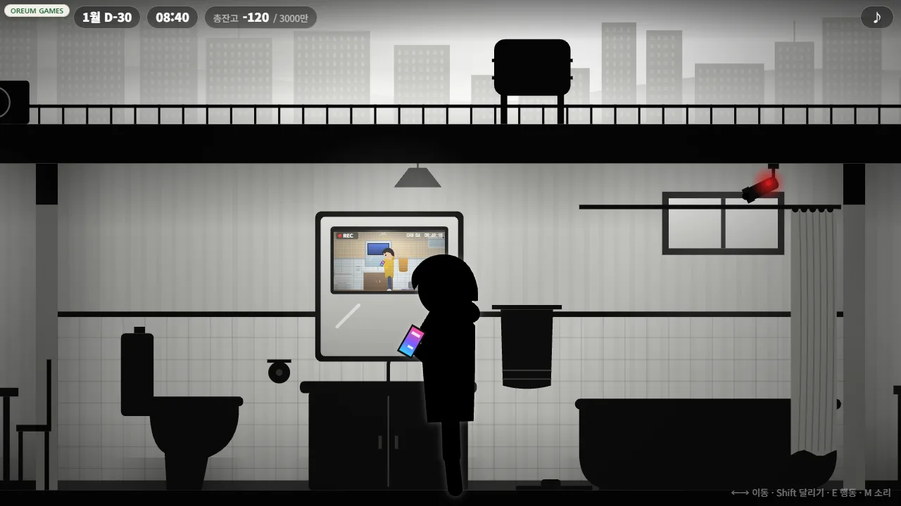
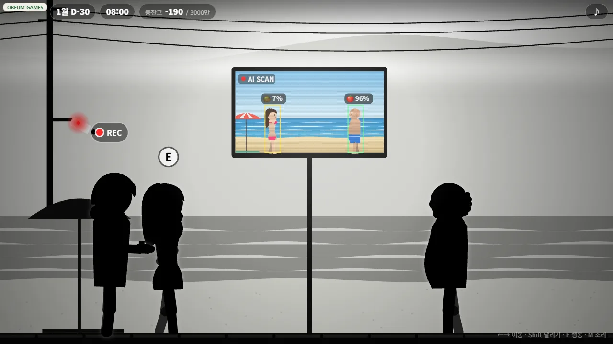
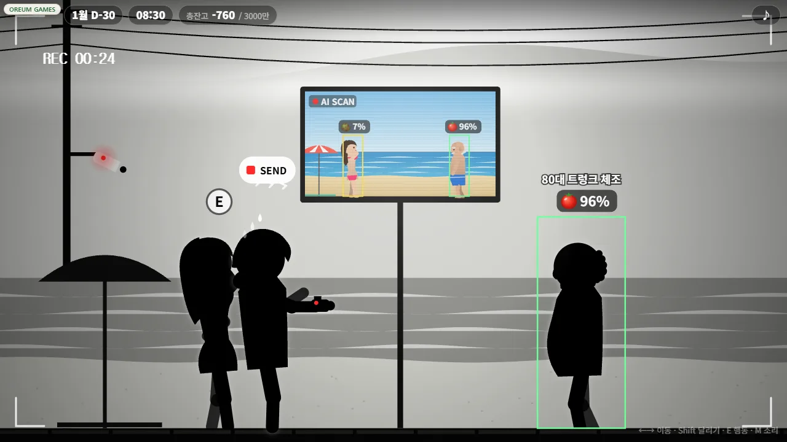

AI가 인간의 일자리를 대체한 시대, 당신의 사생활 영상이 비싼 학습 데이터가 된다면 팔겠습니까? 개발자의 머릿속을 스친 한 문장에서 시작해 기획부터 출시까지 단 하루 만에 탄생한 디스토피아 시뮬레이션 『[월300](/games/wol300/)』의 제작 뒷이야기와 3천만 원짜리 권총 엔딩의 비밀을 공개합니다.

## 한 문장에서 시작된 기묘한 상상

모든 시작은 개발자가 던진 한 문장이었습니다.

“미래 기본소득은 AI 학습용 데이터를 팔아 월 300만 원을 받는 것.”

지금도 수많은 사람이 유튜브나 SNS에 자신의 일상을 찍어 올려 수익을 냅니다. 그렇다면 그 영상을 소비하는 주체가 ‘사람’이 아니라 ‘AI’로 바뀐다면 세상은 어떻게 변할까요? 게임은 이 섬뜩하면서도 현실적인 질문 위에 지어졌습니다.

제목 역시 그 문장에서 곧장 뽑아냈습니다. 거창한 부제나 설명을 붙이자는 의견도 있었지만 개발자는 단 세 글자만 남겼습니다. “‘월300’이라고만 적어야 사람들이 대체 무슨 뜻인지 궁금해하니까요.” 메인 타이틀 화면은 영화 「300」 포스터를 건네며 “이런 느낌으로 가자”고 주문해 완성했습니다. 흑백으로 가라앉은 좁은 원룸, 붉은 붓글씨로 비스듬히 내리꽂힌 ‘월300’, 그리고 침대 머리맡에서 스마트폰만 들여다보는 주인공의 모습이 묘한 긴장감을 자아냅니다.

## CCTV 다섯 대가 곧 기본소득, 하나라도 끄면 빚이 된다

주인공이 사는 집은 현관·거실·주방·욕실·침실까지 총 다섯 칸입니다. 그리고 방마다 천장에 CCTV가 한 대씩 달려 있습니다. 특별한 재주나 콘텐츠가 없다면, 자기 집 안의 일상을 24시간 생중계하는 것이 유일한 기본 수입원입니다.

* 방 1개당 60만 원: 다섯 대를 전부 켜 두면 한 달에 정확히 300만 원이 들어옵니다.
* 남는 돈은 0원: 문제는 한 달 기본 생활비 역시 딱 300만 원이라는 점입니다.
* 프라이버시의 대가: 씻거나 잘 때 창피해서 카메라를 하나라도 끄는 순간, 그만큼 고스란히 빚으로 쌓입니다.

일하지 않아도 굶어 죽지는 않지만, 이 지긋지긋한 감시에서 벗어나 돈을 모으려면 집 밖으로 나가 ‘더 자극적이고 희귀한 무언가’를 찍어 팔아야 합니다. 바깥 골목에도 CCTV가 설치되어 있지만, 이 카메라는 절대 끌 수 없습니다. 철저한 흑백 세상 속에서 유일하게 색채를 띠는 것은 TV와 모니터, 전광판 같은 ‘화면’뿐입니다.

## 20대 비키니 셀카는 7%, 80대 할아버지 체조는 96%

『월300』의 핵심 시스템은 ‘AI 신선도 점수’입니다. 카메라에 담긴 장면이 AI에게 얼마나 희귀한 학습 데이터인지를 퍼센트(%)로 매겨 가격을 책정합니다.

“젊은 여성의 비키니 영상은 인터넷에 넘쳐나서 AI에겐 가치가 낮아요. 반면 80대 할아버지의 트렁크 체조 영상은 사람 소비자는 없어도 AI에겐 엄청나게 신선한 데이터죠.”

이 냉정한 알고리즘 때문에 해변에서 흔한 비키니 셀카를 찍어 팔면 고작 7%를 받지만, 80대 할아버지의 트렁크 차림 체조를 찍으면 무려 96%가 뜹니다. 주인공 캐릭터 역시 20대 여성을 찍을 땐 하트를 날리며 즐거워하다가, 할아버지를 찍을 땐 식은땀을 뻘뻘 흘립니다. 하지만 당장 돈이 급하니 결국 할아버지 뒤를 쫓아다니며 셔터를 누르게 됩니다.

그 밖에도 AI가 열광하는 희귀 데이터는 기상천외합니다.

* 정장 차림으로 놀이터에서 혼자 그네 타는 아저씨
* 버스 정류장에서 진지하게 발레를 추는 아저씨
* 공원에서 비둘기와 진지하게 대화하는 아저씨

실제로 사람들이 소비하는 것은 아가씨지만 AI는 아저씨를 선호한다는 결론입니다(웃음)

집 안에서도 ‘실수’와 ‘치부’가 곧 돈이 됩니다. 라면이 끓어 넘치고, 의자에서 발라당 넘어지고, 샤워하다 비누를 밟고, 밤 10시가 넘어 몰래 냉장고 문을 여는 순간 점수가 올라갑니다. 심지어 아무도 카메라에 담지 않는 화장실 변기 장면은 78%, 포장마차에서 소주 한 잔을 걸치고 가로등을 끌어안은 채 “어떻게 사람 마음이 변하니”라며 우는 장면은 85%의 높은 값을 쳐줍니다. 개발자는 이 시스템의 본질을 한 줄로 요약했습니다. “더 부끄러운 사생활일수록 더 비싸게 팔린다.”

## 최종 목표는 단 하나, 3천만 원짜리 권총 한 자루

돈을 긁어모으는 시뮬레이션이지만, 주인공이 그 돈으로 살 수 있는 물건은 오직 하나뿐입니다.

“목표는 권총 구입 비용 3,000만 원입니다. 3천만 원으로 권총을 사서 감시하는 CCTV를 모두 쏴버리면 엔딩입니다.”

골목 맨 끝 총포사에서 권총을 손에 넣고, 집 안과 골목을 감시하던 CCTV 열세 대를 전부 박살 내는 순간 잿빛이던 세상에 처음으로 찬란한 색채가 번집니다. 반면 1년안에 3천만 원을 모으지 못하면 전혀 다른 결말을 맞이하게 됩니다.

게임의 경제 밸런스 역시 현실적입니다. 같은 장면을 또 찍어 팔면 AI가 이미 학습을 마쳤기 때문에 값이 반토막, 또 반토막으로 뚝뚝 떨어집니다. 초반에는 쉽게 돈을 버는 듯하다가 신선도가 고갈되면서 수입이 가파르게 줄어듭니다. 대신 한동안 팔지 않고 아껴 둔 장면은 이틀마다 조금씩 제값을 회복하므로, 어떤 타이밍에 어떤 치부를 팔지 치밀하게 계산해야 합니다.

## 그림도, 음악도 모두 코드로 짠 ‘하루 만의 기적’

놀라운 점은 이 모든 시스템과 연출이 단 하루 만에 완성되었다는 사실입니다. 별도의 그래픽 리소스나 외주 음원 없이, 화면의 모든 그림부터 낮에 흐르는 나른한 로파이(Lo-Fi) 음악, 밤의 서늘한 환경음, 녹화 버튼이 돌아갈 때의 째깍거리는 효과음까지 전부 프로그래밍 코드로 클로드 코드가 구현했습니다.

게임 속 하루는 아침 8시에 시작해 밤 12시에 끝나며, 30일이 지나면 냉정한 월말 정산표가 날아옵니다. 『[월300](/games/wol300/)』은 별도의 다운로드나 회원가입 없이 PC와 스마트폰 브라우저에서 지금 바로 무료로 플레이할 수 있습니다. (해외 유저를 위한 영어판 『300 A MONTH』도 함께 공개되었습니다.)
