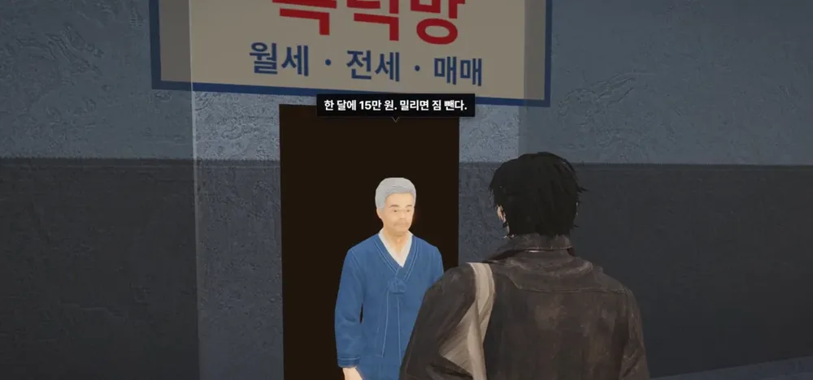
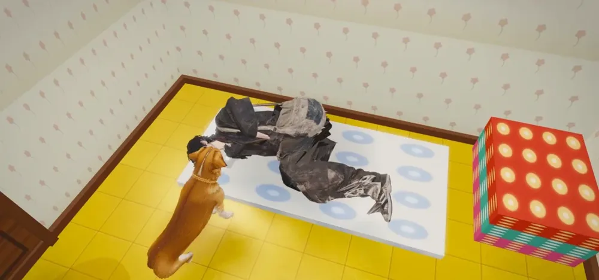
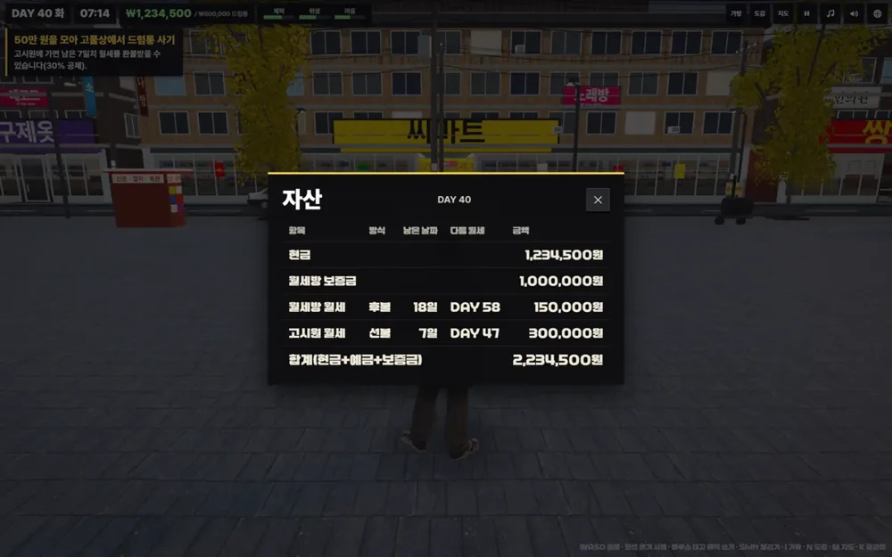
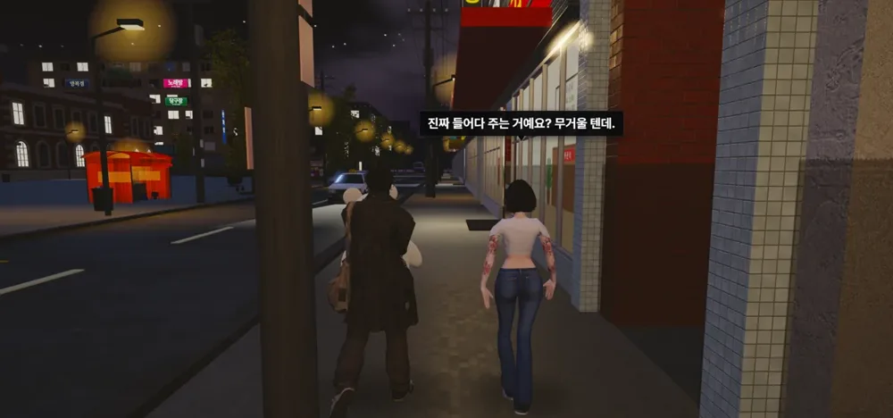
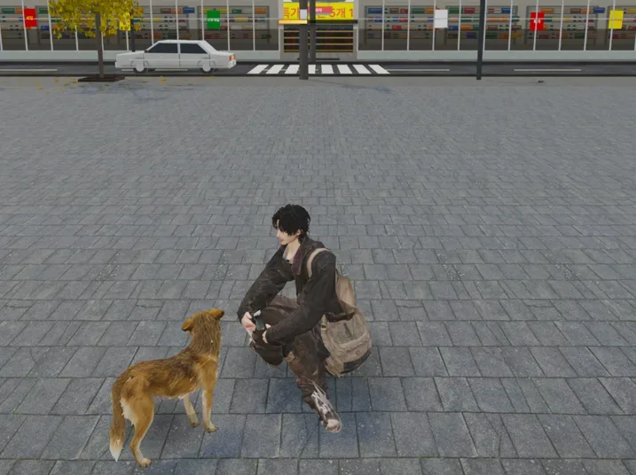
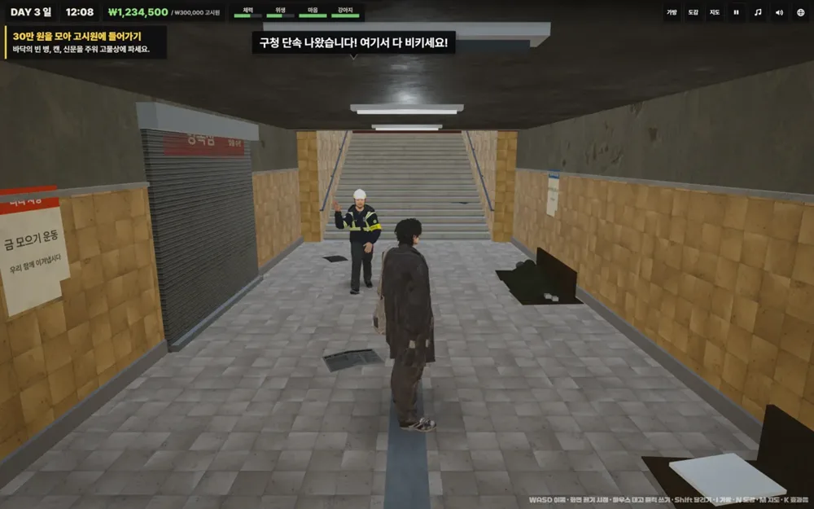

## 매일 기계처럼 노가다 뛰어서 힘들게 100만 원을 모았는데 너무 싱거웠다

100만 원을 모아 복덕방 문을 누르면 돈이 빠지고 방에 누운 모습이 나오고 끝이었다. 노숙하던 사람이 처음 자기 방을 얻는 순간인데 너무 싱거웠다.

그래서 다시 만들었다. 복덕방 하르방이 개 받아 주는 방은 광장 여인숙 월세방 하나뿐이라며 앞장선다. 맨 안쪽 7호 문을 열면 노란 장판 방이다. 형광등이 깜빡이다 켜지고, 강아지가 먼저 뛰어 들어가고, 주인공은 우리 집이다 하고 눕는다.

## 방을 구했는데 고시원에서 잤다

방을 구하고도 버릇처럼 고시원 문을 눌렀더니 들어가서 잤다. 이제 월세방을 얻으면 고시원은 방을 뺀 걸로 치고, 총무를 찾아가면 남은 날짜만큼 30%를 떼고 환불해 준다. 화면 위 돈 칸을 누르면 남은 날짜와 다음 월세가 표로 나오게도 했다.

## 곰인형 들고 퇴근길

편의점 그녀에게 커다란 곰인형을 선물하면 그녀가 이거 들고 집에 어떻게 가지 하고, 주인공이 내가 들어다줄게요 한다. 그다음이 없어서 둘이 곰인형을 들고 걸어가는 장면을 클로드한테 만들라고 했다.

처음 가져온 건 갈색 공 몇 개를 붙인 손바닥만 한 곰이었다. 곰을 건네받는 그녀는 서서 안는 게 아니라 무릎을 꿇었다. 카메라는 가게 벽 속으로 들어가서 벽만 찍혔다.

흰색으로 사람만 하게 키우라고 했더니 1미터 반짜리 곰이 주인공을 통째로 가렸다. 크고 보송거리지도 않는다고 했더니 털을 겹겹이 씌우고 1미터 10센티로 줄였다. 그래도 커서 80센티까지 줄였다.

팔 사이에 끼우지는 못하냐고 물었더니 곰은 몸 앞에 혼자 둥둥 떠 있었다. 곰만 완전히 따로 논다고 했더니 이번엔 두 손이 곰 배를 뚫고 나왔다. 그걸 고치다가 상관도 없는 그녀 첫 만남 장면 뒷부분을 지워 버렸다가 되살리기까지 했다.

결국 그만하고 첫 장면, 둘이 나란히 걸어가는 뒷모습에서 끝내자고 했다. 그랬더니 뒷모습 끝나고 옆모습이 0.5초 보였다. 그것까지 빼고 나서야 끝났다. 뒷모습이 제일 좋았다.

## 손목이 다 꺾여 있었다

주인공이나 그녀가 가만히 서 있을 때 손목이 안쪽으로 기괴하게 꺾여 있었다. 고치라고 했더니 서 있을 때 손목은 곧게 폈다.

그런데 손을 들 때는 그대로였다. 떡할머니도, 그녀도, 단속반도 손만 들면 팔이 뒤로 꺾이거나 비틀렸다. 걷는 자세나 계산대 자세 위에 정해진 각도를 그냥 더하는 방식이라 사람마다 다르게 꼬였던 것이다. 그래서 사람들을 길에 한 줄로 세워 놓고 다 같이 손을 들게 하면서 자세를 바로잡았다. 이제는 팔을 옆으로 들어 손바닥이 얼굴 옆에 온다.

강아지 밥 줄 때 무릎 꿇던 것도 쪼그려 앉게 했고, 그녀가 강아지를 쓰다듬을 때도 쪼그려 앉는다. 대신 그녀가 쓰다듬으며 손을 위아래로 움직이던 동작은 빠졌다.

## 단속반이 호루라기만 불고 갔다

짤짤이를 하는데 구청 단속반이 호루라기만 불고 아무 일도 없었다. 단속반은 광장 위 정해진 길만 돌다가 바로 부딪쳐야 반응했는데, 짤짤이 자리는 그 길에서 떨어져 있었다. 그래서 단속반이 판으로 와서 도박은 불법이라며 판을 깨게 했다.

그런데 지하도에서도 호루라기만 불고 끝이었다. 지하도는 아예 검사에서 빠져 있었다. 단속반이 내려와 쫓아내게 했더니 쫓겨나기는 하는데 단속반이 안 보였다. 말풍선만 천장 근처에 떠 있었다.

처음엔 주인공 바로 뒤에 세워서 몸에 가린 줄 알고 옮겼다. 다음엔 카메라 뒤에 서 있는 줄 알고 화면 안쪽에서 걸어오게 했다. 그래도 안 보였다. 위치 값을 하나하나 찍어 보고 나서야 알았다. 지하에서 처음 생긴 사람은 키를 잘못 재서 몸이 3미터 위 천장 속에 떠 있었다.

그걸 고치니 단속반이 계단으로 내려왔고, 지하도 구석에 쪼그려 앉은 노숙인도 보였다. 그동안 거기 있었는데 안 보였던 것이다.

## 홈리스1999는 그래픽카드가 없는 저사양 PC에서 돌아가는 게임을 지향한다

홈리스1999를 만드는 컴퓨터는 인텔 i5 노트북이다. 그래픽카드가 따로 없고 CPU에 붙은 Iris Xe 내장 그래픽으로 돌린다. 램은 16GB다. 그래도 이 정도면 사양이 좋은 편이다. 다들 최신 컴퓨터를 살 형편이 되는 건 아니니까, 이 노트북에서 겨우 도는 게임이면 안 되고 이보다 낮은 컴퓨터에서도 끊기지 않아야 한다.

처음 PC판을 켰을 때는 화면 해상도를 그대로 다 그려서 1초에 20장 남짓밖에 안 나왔다. 그래서 그리는 해상도를 낮추고, 느리면 알아서 더 낮추게 했다. 설정에서 그래픽 품질을 자동, 중간, 최고 가운데 고를 수도 있다. 지금 이 노트북에서 1080p 중간 품질이면 1초에 70장쯤 나온다.

스팀에 적은 최소 사양도 그래픽카드가 없는 컴퓨터다. 인텔 i5 8세대, UHD 620 내장 그래픽, 램 8GB. 비싼 그래픽카드가 있어야 하는 실사 그래픽 대신, 사진에서 딴 재질과 빛, 그림체로 화면을 채운다.

스팀출시 예정일은 12월 15일이다
